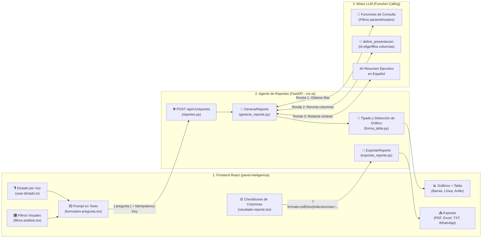

# Guía de Replicación: Sistema de Reportes Dinámicos con IA (Texto, Voz, Filtros, Columnas y Exportación PDF/Excel/TXT)

> **Propósito:** Esta guía documenta paso a paso cómo está construido el módulo de **Reportes Dinámicos Generativos** de AdOrbit para poder **replicarlo tal cual en cualquier otro software** (ERP, clínica, e-commerce, logística, fintech, etc.). Cubre únicamente el flujo y código del **Agente Generador de Reportes**, la entrada por **Texto, Voz y Filtros**, la **Selección de Columnas** (por IA y por UI), los **Gráficos Automáticos** y la **Exportación a PDF, Excel (`.xlsx`), TXT y WhatsApp**.

---

## 1. Flujo Completo del Agente de Reportes (De Extremo a Extremo)



---

## 2. Qué Hace Exactamente el Agente de Reportes en el Backend

Archivos clave:
* [`servicios/ms-ia/app/use_cases/generar_reporte.py`](file:///c:/Users/Usuario/Desktop/2-2026/sw-2doP/adorbit/servicios/ms-ia/app/use_cases/generar_reporte.py)
* [`servicios/ms-ia/app/adapters/llm/groq_cliente.py`](file:///c:/Users/Usuario/Desktop/2-2026/sw-2doP/adorbit/servicios/ms-ia/app/adapters/llm/groq_cliente.py)
* [`servicios/ms-ia/app/use_cases/compartido/forma_tabla.py`](file:///c:/Users/Usuario/Desktop/2-2026/sw-2doP/adorbit/servicios/ms-ia/app/use_cases/compartido/forma_tabla.py)
* [`servicios/ms-ia/app/api/reportes.py`](file:///c:/Users/Usuario/Desktop/2-2026/sw-2doP/adorbit/servicios/ms-ia/app/api/reportes.py)

### Paso 1: Recepción e Idempotencia (`POST /api/v1/reportes`)
Recibe `{ "pregunta": "..." }` y el header `Idempotency-Key`. Si la misma petición ya fue procesada, devuelve el reporte guardado en base de datos sin volver a llamar al LLM.

### Paso 2: Bucle de Razonamiento y *Tool Calling* (Hasta 4 rondas)
El método `GenerarReporte._generar()` mantiene una conversación con el LLM (`temperature=0.2`) pasándole dos tipos de herramientas (`tools`):

1. **Herramientas de Consulta de Datos (Criterios de Selección):**
   El LLM nunca genera SQL libre. En su lugar, elige una función parametrizada según lo que pidió el usuario, extrayendo del texto o audio los filtros (ej. `estado`, `cliente_id`, `desde`, `hasta`, `dias`):
   ```python
   {
       "type": "function",
       "function": {
           "name": "consultar_campanas",
           "description": "Lista campañas, opcionalmente filtradas por estado, cliente o rango de fechas.",
           "parameters": {
               "type": "object",
               "properties": {
                   "estado": {"type": "string", "description": "borrador|activa|pausada|finalizada|cancelada"},
                   "cliente_id": {"type": "string"},
                   "desde": {"type": "string", "description": "YYYY-MM-DD"},
                   "hasta": {"type": "string", "description": "YYYY-MM-DD"},
               },
           },
       },
   }
   ```

2. **Herramienta de Selección de Columnas por IA (`definir_presentacion`):**
   Si el usuario pide en su prompt o por voz qué columnas quiere ver (ej. *"Muéstrame las campañas activas, pero solo quiero el nombre y el gasto actual"* o *"sin los IDs"*), después de recibir los datos en la Ronda 1, el LLM llama en la Ronda 2 a `definir_presentacion`:
   ```python
   HERRAMIENTA_PRESENTACION = {
       "type": "function",
       "function": {
           "name": "definir_presentacion",
           "description": (
               "Define qué columnas del último resultado se muestran en el reporte y en qué orden. "
               "Úsala SOLO después de obtener datos y cuando el usuario pida ver u ocultar ciertos datos."
           ),
           "parameters": {
               "type": "object",
               "properties": {
                   "columnas": {
                       "type": "array",
                       "items": {"type": "string"},
                       "description": "Claves exactas de columnas del resultado, en el orden deseado",
                   }
               },
               "required": ["columnas"],
           },
       },
   }
   ```
   El backend verifica que las columnas elegidas por la IA existan dentro de las claves reales de las filas (`validas = [c for c in columnas_elegidas if c in disponibles]`) y recorta/reordena la tabla automáticamente.

3. **Síntesis Ejecutiva en Lenguaje Natural (`respuesta_nl`):**
   Con las filas ya obtenidas, el LLM responde en español con un párrafo ejecutivo que resume los hallazgos clave y da una recomendación, sin inventar números.

### Paso 3: Tipado Semántico de Columnas y Autodetección de Gráfico (`forma_tabla.py`)
En [`forma_tabla.py`](file:///c:/Users/Usuario/Desktop/2-2026/sw-2doP/adorbit/servicios/ms-ia/app/use_cases/compartido/forma_tabla.py):
* **Diccionario `_METADATOS_COLUMNA`:** Convierte cada nombre de campo (`presupuesto_total`, `fecha_inicio`, `estado`) en un objeto con etiqueta legible y tipo semántico (`texto`, `dinero`, `numero`, `porcentaje`, `fecha`). Si aparece una columna nueva no registrada, genera su etiqueta automáticamente (`clave.replace("_", " ").capitalize()`).
* **Función `grafico_dto(columnas, filas)`:** Analiza las columnas del resultado buscando **1 columna categórica/fecha (eje X)** y **1 columna numérica/dinero (eje Y)**, descartando columnas técnicas (`*_id`):
  * Si el eje X es de tipo `fecha`, sugiere `"tipo": "linea"`.
  * Si el eje X es de tipo `texto` (ej. nombre de campaña o cliente), sugiere `"tipo": "barras"`.

### Paso 4: Contrato JSON que Devuelve el Backend al Frontend
```json
{
  "id": "d290f1ee-6c54-4b01-90e6-d701748f0851",
  "pregunta": "Campañas activas solo con nombre y gasto actual",
  "titulo": "Campañas",
  "generado_en": "2026-11-11T20:30:00Z",
  "interpretacion": {
    "herramienta": "consultar_campanas",
    "parametros": { "estado": "activa" }
  },
  "columnas": [
    { "clave": "nombre", "etiqueta": "Nombre", "tipo": "texto" },
    { "clave": "gasto_actual", "etiqueta": "Gasto actual", "tipo": "dinero", "moneda": "BOB" }
  ],
  "columnas_disponibles": [
    { "clave": "campana_id", "etiqueta": "ID de campaña", "tipo": "texto" },
    { "clave": "nombre", "etiqueta": "Nombre", "tipo": "texto" },
    { "clave": "estado", "etiqueta": "Estado", "tipo": "texto" },
    { "clave": "presupuesto_total", "etiqueta": "Presupuesto total", "tipo": "dinero", "moneda": "BOB" },
    { "clave": "gasto_actual", "etiqueta": "Gasto actual", "tipo": "dinero", "moneda": "BOB" }
  ],
  "presentacion_ia": true,
  "filas": [
    { "campana_id": "...", "nombre": "Verano 2027", "estado": "activa", "presupuesto_total": 50000, "gasto_actual": 32000 }
  ],
  "grafico": { "tipo": "barras", "x": "nombre", "y": "gasto_actual" },
  "respuesta_nl": "Actualmente existen campañas activas con un gasto acumulado de Bs 32.000,00...",
  "estado": "listo"
}
```

---

## 3. Cómo Funciona el Frontend (Voz, Prompt, Filtros, Columnas y Gráficos)

Archivos clave en [`aplicaciones/panel-inteligencia/src/`](file:///c:/Users/Usuario/Desktop/2-2026/sw-2doP/adorbit/aplicaciones/panel-inteligencia/src/):

### 3.1. Dictado por Voz (`utilidades/usar-dictado.ts`)
Archivo: [`usar-dictado.ts`](file:///c:/Users/Usuario/Desktop/2-2026/sw-2doP/adorbit/aplicaciones/panel-inteligencia/src/utilidades/usar-dictado.ts).
* Usa la API nativa del navegador (`window.SpeechRecognition` / `window.webkitSpeechRecognition`) sin librerías externas.
* Flujo exacto del hook `useDictado(alTexto)`:
  1. Llama a `navigator.mediaDevices.getUserMedia({ audio: true })` para verificar y activar el permiso de micrófono en el navegador, y cierra las pistas de prueba inmediatamente.
  2. Configura `r.lang = 'es-BO'`, `r.continuous = false`, `r.interimResults = true`.
  3. En `r.onresult`, une las transcripciones parciales y finales y actualiza en vivo la caja de texto del prompt (`alTextoRef.current(texto.trim())`).
  4. Mapea todos los códigos de error (`not-allowed`, `no-speech`, `audio-capture`, `network`) a mensajes claros en español.

### 3.2. Caja de Prompt + Chips + Constructor de Filtros
Archivos: [`formulario-pregunta.tsx`](file:///c:/Users/Usuario/Desktop/2-2026/sw-2doP/adorbit/aplicaciones/panel-inteligencia/src/componentes/formulario-pregunta.tsx) y [`filtros-analisis.tsx`](file:///c:/Users/Usuario/Desktop/2-2026/sw-2doP/adorbit/aplicaciones/panel-inteligencia/src/componentes/filtros-analisis.tsx).
* El usuario tiene **3 formas de disparar un reporte** sobre el mismo componente:
  1. **Escribiendo libremente** en el `<textarea>` (con soporte para pedir filtros y columnas en lenguaje natural).
  2. **Dictando con el botón `Dictar`** (que transcribe la voz al `<textarea>`).
  3. **Usando el desplegable `Filtros de análisis`**, donde selecciona en listas desplegables e inputs de fecha el tipo de reporte, el estado, el rango `Desde`/`Hasta` o los días de vencimiento; al pulsar **Aplicar filtros**, el componente construye la oración en lenguaje natural y la envía a `alConsultar(pregunta)`.

### 3.3. Selector Interactivo de Columnas (`resultado-reporte.tsx`)
Archivo: [`resultado-reporte.tsx`](file:///c:/Users/Usuario/Desktop/2-2026/sw-2doP/adorbit/aplicaciones/panel-inteligencia/src/componentes/resultado-reporte.tsx#L37-L72).
* Inicializa el estado `visibles` con las columnas que seleccionó la IA (`reporte.columnas`), pero conserva todas las columnas posibles en `disponibles` (`reporte.columnas_disponibles`).
* Muestra el botón **`Columnas (visibles/disponibles)`** que abre un panel con checkboxes por cada columna disponible.
* Cuando el usuario marca o desmarca una columna:
  1. La tabla en pantalla ([`tabla-datos.tsx`](file:///c:/Users/Usuario/Desktop/2-2026/sw-2doP/adorbit/aplicaciones/panel-inteligencia/src/componentes/tabla-datos.tsx)) se actualiza al instante mostrando solo `columnasMostradas`.
  2. Cuando el usuario pulsa **PDF**, **Excel**, **TXT** o **WhatsApp**, el frontend pasa ese arreglo `visibles` al backend (`GET /api/v1/reportes/{id}/exportar?formato=xlsx&columnas=nombre,gasto_actual`).

### 3.4. Gráficos y KPIs Automáticos
Archivos: [`indicadores.tsx`](file:///c:/Users/Usuario/Desktop/2-2026/sw-2doP/adorbit/aplicaciones/panel-inteligencia/src/componentes/indicadores.tsx), [`grafico-barras.tsx`](file:///c:/Users/Usuario/Desktop/2-2026/sw-2doP/adorbit/aplicaciones/panel-inteligencia/src/componentes/grafico-barras.tsx), [`grafico-linea.tsx`](file:///c:/Users/Usuario/Desktop/2-2026/sw-2doP/adorbit/aplicaciones/panel-inteligencia/src/componentes/grafico-linea.tsx), [`grafico-anillo.tsx`](file:///c:/Users/Usuario/Desktop/2-2026/sw-2doP/adorbit/aplicaciones/panel-inteligencia/src/componentes/grafico-anillo.tsx) y [`resumen-visual.tsx`](file:///c:/Users/Usuario/Desktop/2-2026/sw-2doP/adorbit/aplicaciones/panel-inteligencia/src/componentes/resumen-visual.tsx).
* Permite alternar con un clic entre vista de **Barras / Tendencia**, **Distribución (Anillo)** y **Tarjetas**, además de renderizar siempre la tabla accesible debajo.

---

## 4. Cómo Funciona la Exportación a PDF, Excel, TXT y WhatsApp

Archivo clave: [`servicios/ms-ia/app/use_cases/exportar_reporte.py`](file:///c:/Users/Usuario/Desktop/2-2026/sw-2doP/adorbit/servicios/ms-ia/app/use_cases/exportar_reporte.py).

Cuando se invoca `ExportarReporte.ejecutar(id_reporte, formato, columnas)`:
1. Recupera el `ReporteGenerado` desde PostgreSQL.
2. Si el usuario envió `columnas` personalizadas desde los checkboxes de la UI, reemplaza `reporte.columnas` por esa selección ordenada.
3. Limpia el texto de `respuesta_nl` (`_resumen_limpio`) para quitar cualquier formato Markdown y dejar un párrafo limpio de resumen ejecutivo.
4. Genera el archivo en memoria (`io.BytesIO`, sin crear archivos basura en disco):
   * **En Excel (`_exportar_xlsx` con `openpyxl`):**
     * Crea la hoja **`Reporte`** con el logo PNG generado en memoria (`Pillow`), título, pregunta, fecha, resumen ejecutivo de la IA y la tabla con encabezados en color corporativo (`#4F46E5`), formatos numéricos/monetarios (`"Bs" #,##0.00`), fechas (`dd/mm/yyyy`), paneles inmovilizados (`freeze_panes`) y autofiltros.
     * Si el reporte tiene columna de texto + columna numérica, crea automáticamente una segunda hoja **`Gráfico`** con un gráfico de barras nativo de Excel (`BarChart`).
   * **En PDF (`_exportar_pdf` con `reportlab`):**
     * Crea un documento A4 horizontal (`landscape(A4)`) con logo, membrete, resumen ejecutivo de la IA, tabla autoajustada al ancho de página y, en una segunda página, un `HorizontalBarChart` vectorial con pie de página numerado.
   * **En TXT (`_exportar_txt`) y WhatsApp (`mensaje-whatsapp.ts`):**
     * Arma una tabla ASCII alineada con cálculo automático de **Totales y Promedios (KPIs)** por cada columna numérica, o abre `api.whatsapp.com/send` con el resumen formateado.

---

## 5. Pasos para Copiar este Módulo a Otro Proyecto

Para llevar estos reportes dinámicos a otro sistema, solo necesitas copiar y adaptar estos **8 archivos**:

### En el Backend (Python + FastAPI)
1. **`groq_cliente.py`** ([ver archivo](file:///c:/Users/Usuario/Desktop/2-2026/sw-2doP/adorbit/servicios/ms-ia/app/adapters/llm/groq_cliente.py)): Cambia las 4 funciones de `HERRAMIENTAS_MCP` por las consultas de tu nuevo software (ej. `consultar_ventas`, `productos_bajo_stock`, `pacientes_atendidos`) y **deja intacta `HERRAMIENTA_PRESENTACION` (`definir_presentacion`)**.
2. **`generar_reporte.py`** ([ver archivo](file:///c:/Users/Usuario/Desktop/2-2026/sw-2doP/adorbit/servicios/ms-ia/app/use_cases/generar_reporte.py)): Solo actualiza el `if nombre == "..."` en `_ejecutar_herramienta()` para que llame a tus funciones de consulta. El bucle de IA, el recorte de columnas y la construcción de la tabla no cambian.
3. **`forma_tabla.py`** ([ver archivo](file:///c:/Users/Usuario/Desktop/2-2026/sw-2doP/adorbit/servicios/ms-ia/app/use_cases/compartido/forma_tabla.py)): Pon en `_METADATOS_COLUMNA` los nombres de las columnas de tu nuevo negocio y su tipo (`dinero`, `numero`, `fecha`, `porcentaje`, `texto`).
4. **`exportar_reporte.py`** ([ver archivo](file:///c:/Users/Usuario/Desktop/2-2026/sw-2doP/adorbit/servicios/ms-ia/app/use_cases/exportar_reporte.py)) y **`reportes.py`** ([ver archivo](file:///c:/Users/Usuario/Desktop/2-2026/sw-2doP/adorbit/servicios/ms-ia/app/api/reportes.py)): Cópialos tal cual; solo cambia el texto `"AdOrbit"` en `_logo_png()` y en el pie de página del PDF por el nombre de tu nuevo sistema.

### En el Frontend (React + TypeScript)
5. **`usar-dictado.ts`** ([ver archivo](file:///c:/Users/Usuario/Desktop/2-2026/sw-2doP/adorbit/aplicaciones/panel-inteligencia/src/utilidades/usar-dictado.ts)): Cópialo sin cambios (100% reutilizable para dictado por voz en español).
6. **`formulario-pregunta.tsx`** ([ver archivo](file:///c:/Users/Usuario/Desktop/2-2026/sw-2doP/adorbit/aplicaciones/panel-inteligencia/src/componentes/formulario-pregunta.tsx)) y **`filtros-analisis.tsx`** ([ver archivo](file:///c:/Users/Usuario/Desktop/2-2026/sw-2doP/adorbit/aplicaciones/panel-inteligencia/src/componentes/filtros-analisis.tsx)): Solo cambia el arreglo `EJEMPLOS` y las opciones de filtro por las de tu nuevo dominio.
7. **`resultado-reporte.tsx`** ([ver archivo](file:///c:/Users/Usuario/Desktop/2-2026/sw-2doP/adorbit/aplicaciones/panel-inteligencia/src/componentes/resultado-reporte.tsx)) + **`tabla-datos.tsx`** ([ver archivo](file:///c:/Users/Usuario/Desktop/2-2026/sw-2doP/adorbit/aplicaciones/panel-inteligencia/src/componentes/tabla-datos.tsx)) + **`grafico-*.tsx`**: Son **100% genéricos**; pintan automáticamente cualquier tabla, selector de columnas con checkboxes, gráficos y botones de exportación a partir del JSON del backend.
